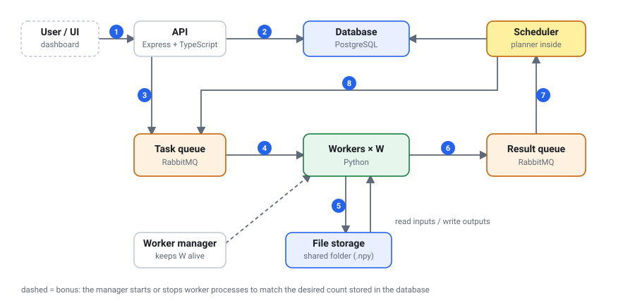
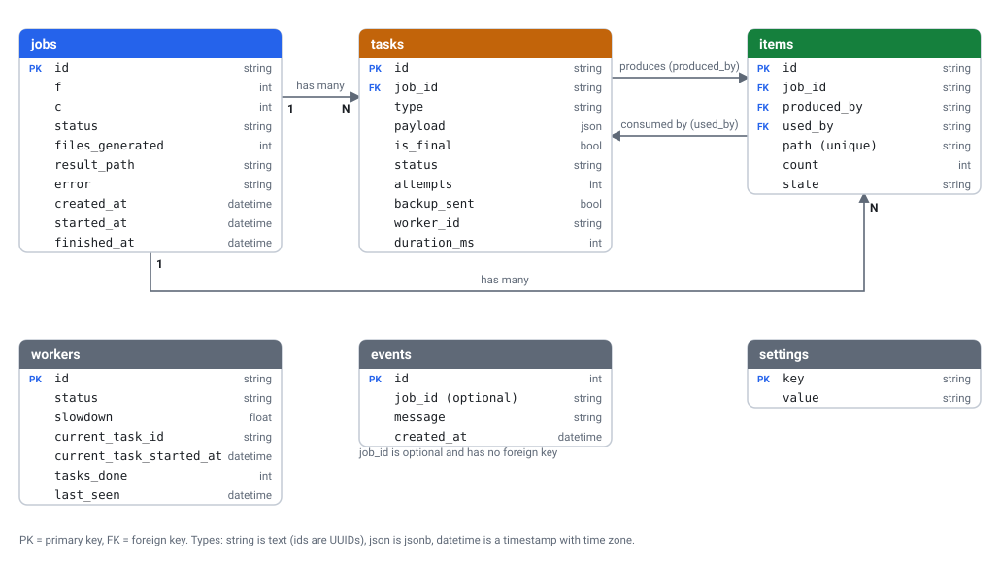

# Distributed Mean: Design Document

**Author:** Reetesh Kumar · **Stack:** Node.js, Express, TypeScript, Python, PostgreSQL, RabbitMQ, Docker Compose

---

## 1. Summary

The system takes a big job, splits it into small tasks, runs them on a pool of W workers, and combines the outputs into one result.

The job it runs is a per-index mean. The user picks F files with C random numbers each and gets back one file with the mean of every position. For example, `[1, 2, 3]` and `[4, 5, 6]` give `[2.5, 3.5, 4.5]`.

The key idea: a task never returns averages. It returns the **sum of each position and a count** of the files behind it. Sums can be added in any order, so partial results are combined as soon as they are ready. The division happens once, at the end.

---

## 2. Requirements

**Functional**

1. Create a job with F and C (1 < F < 100,000 and 1 < C < 1,000,000).
2. Split it into tasks of at most 5 files, run them on W workers, and combine everything into one result file.
3. Check status and progress, download the result, cancel.
4. Run many jobs at the same time. *(Bonus: change W through the API, and a UI with live state and logs.)*

**Non-functional**

1. **Efficient.** Workers rarely sit idle, and a slow worker never holds up a fast one.
2. **Correct.** The result is the true mean, however the work was split.
3. **Reliable.** If a worker crashes, its task is retried. No file is lost or counted twice.
4. **Fair and scalable.** A big job doesn't block a small one. The full range works, up to 99,999 files of 999,999 numbers.

## 3. Out of scope

- Accounts and authentication
- Running on several machines or in the cloud (it runs locally with Docker Compose)
- Keeping results long term

---

## 4. Core entities

| Entity | Meaning |
|---|---|
| Job | One user request: F, C, status, result |
| Task | One unit of work for a worker: generate up to 5 files, or combine up to 5 items |
| Item | A piece of data waiting to be combined: a raw file, or a partial result. It is a list of C sums plus a count of the files behind it. A raw file is an item with count 1. |
| Worker | A Python process that takes one task at a time from the queue. The W workers are shared by all jobs. |

---

## 5. API

| Method | Endpoint | Purpose |
|---|---|---|
| POST | `/jobs` | Create a job. Body `{"F": 1000, "C": 5000}`, returns `202 {"jobId"}`. `400` if F or C is out of range. |
| GET | `/jobs` | List jobs with status and progress |
| GET | `/jobs/:id` | One job: status, progress, timestamps, error, task counts. `404` if unknown. |
| GET | `/jobs/:id/result` | Download the result as CSV. `409` if not completed. Supports `Range` (the UI uses it for a preview). |
| DELETE | `/jobs/:id` | Cancel. `409` if already finished. |
| GET | `/workers` | Workers with status, slowdown, tasks done, current task, last heartbeat |
| PUT | `/workers` | Change W. Body `{"count": 5}`, 0 to 32. *(bonus)* |
| GET | `/stats` | Counters: jobs by status, tasks queued, workers by status, retries, backup copies |
| GET | `/events` | Activity log, 100 lines at a time. `?after=<id>` for newer lines, `?job=<id>` for one job. *(bonus)* |
| GET | `/` | The web UI *(bonus)* |

---

## 6. High-level design

1. The user creates a job through the **API**.
2. The API saves the job and its tasks in the **database**.
3. The API puts the first tasks (generate the files) on the **task queue**.
4. A free **worker** takes one task.
5. The worker reads its inputs from **file storage**, does the work, and writes its output there.
6. The worker reports "done, here is the count" on the **result queue**.
7. The **scheduler** reads the result and saves the output in the database as a waiting item.
8. The scheduler decides what comes next. Once 5 items are waiting, it creates a combine task. When everything left fits in one task and nothing else is running, it creates the **final task**, which also does the division. New tasks go to the task queue. When the final task finishes, the job is done.

Steps 4 to 8 repeat until the job is done. The bonus **worker manager** (dashed) starts and stops worker processes to match W.

**What runs** (Docker Compose, with one shared `data/` folder as file storage):

| Service | What it is | Job |
|---|---|---|
| `postgres` | PostgreSQL 16 | Jobs, tasks, items, workers, settings, events |
| `rabbitmq` | RabbitMQ 3 | The `tasks` and `results` queues |
| `api` | Node, HTTP server | REST API and web UI. Never touches the numbers. |
| `scheduler` | Node, same image as the API | Applies results, plans combines, publishes tasks, finds dead workers, sends backup copies. **Always exactly one instance**, so two planners can never race. All its state is in the database, so a restart is safe. |
| `workers` | Python worker manager, which starts W worker processes | Generate and combine files. Send a heartbeat every 2 s. |

---

## 7. Data model

**Types.** The diagram uses plain types. In PostgreSQL, ids are `uuid`, `string` is `text`, `json` is `jsonb`, `datetime` is `timestamptz` and `float` is `real`. The exact definitions are in `db/schema.sql`.

**What goes where.** The database keeps small facts: what exists, its status, where it is, its count. The numbers are in `.npy` files in the shared folder, one file per item, C values each, in position order.

**Tasks and items.** A task is work, an item is data, and a task doesn't "contain" items. It produces them and consumes them:

- A GENERATE task has no input items. It produces raw items with count 1.
- A COMBINE task consumes up to 5 items and produces one new item. `produced_by` and `used_by` on the item record both links, and the task payload keeps a copy of the inputs.
- The final task produces the result file. Its path is stored on the job, not as an item.
- Waiting items are the items with state `READY`. When the planner creates a combine task, it sets the inputs to `USED` in the same transaction, so two tasks can never take the same item.
- `items.path` is unique, so the same result can't be saved twice.

**States**

| Object | Normal path | Also |
|---|---|---|
| **Job** | `PENDING` → `RUNNING` → `COMPLETED` | `RUNNING` can end as `FAILED` or `CANCELLED` instead. A job moves to `RUNNING` when its first task finishes. |
| **Task** | `PENDING` → `QUEUED` → `DONE` | `PENDING` means not on the queue yet. `QUEUED` means on the queue or running. A failed attempt returns to `PENDING`, up to 3 attempts, then the task is `FAILED`. |
| **Item** | `READY` → `USED` | `READY` means waiting to be combined. `USED` means a task has taken it. |
| **Worker** | `IDLE` ⇄ `BUSY` | `DRAINING` while it finishes its last task before exiting. `DEAD` when its heartbeat is older than 10 s. |

---

## 8. Key design decisions

| # | Topic | Decision | Why |
|---|---|---|---|
| 1 | Combining results | Tasks return per-position sums and a count, never averages. | Averages of groups of different sizes are wrong, and the 5-file limit makes groups of different sizes certain. Sums add in any order. Files are stored as float32 and added in float64, so no precision is lost. |
| 2 | Splitting a job | ⌈F / 5⌉ generate tasks, then at least (F − 1) / 4 combine tasks, each with at most 5 inputs. Workers generate the files. | Each combine of 5 turns 5 items into 1. At F = 99,999 that is about 20,000 plus 25,000 tasks. Generating on workers keeps the API fast and lets combining start early. |
| 3 | The 5-file limit | Checked in five places: the planner never builds a task with more than 5 inputs, workers take one task at a time (`prefetch = 1`), a worker rejects a task with more than 5 inputs, it loads one input at a time, and a 512 MB memory cap applies to each worker. | The limit stands in for RAM, so it must hold for every task. At C = 999,999 a file is about 4 MB. |
| 4 | Distributing work | Workers pull one task at a time. Items are combined as soon as they are ready, at any level. | Fast workers do more tasks without anyone planning it, and nobody waits for a "round" to end. Different speeds are simulated with a per-worker slowdown (`WORKER_SLOWDOWN`, default `1,1,3`, so every third worker is 3× slower). |
| 5 | Slow workers | If a worker is idle, the queue is empty, and a task has run longer than 2× the median (and at least 1 s), publish one backup copy. The first result wins. | A slow worker can't delay the end of a job. MapReduce uses the same trick for stragglers. |
| 6 | Knowing a job is done | The final task is created only when all files exist, nothing else is running, and what is left fits in one task. Its count must equal F. | If count = F, the job is `COMPLETED`. If not, it is `FAILED` with a message, so a missed or doubled file never turns into a wrong mean. Progress is (files generated + merges done) / (2F − 1), shown as at most 99% until done. |
| 7 | Many jobs | The queue is kept short (about 2 × W tasks) and refilled in turns between jobs: the first task of every job, then the second of every job. A task is published first, and marked `QUEUED` only after the broker confirms. | A big job can't block a small one. Measured: a job with F = 10, submitted after one with F = 3,000, finished in 3 s while the big one took 37 s. |
| 8 | Failures and duplicates | Messages are delivered at least once and handled idempotently. Each result is applied in one database transaction, and the message is acknowledged only after the commit. | A result for a finished task is ignored, `items.path` is unique, and the final count must equal F. A crashed worker's task goes back to the queue. No heartbeat for 10 s marks a worker dead. A task gets 3 attempts, then the job fails. A malformed result message is dropped (retrying it would fail forever), and the scheduler reconnects to RabbitMQ if the connection drops. |
| 9 | Cancel | Tasks not yet published are failed at once. Running tasks finish, and their results are discarded. Workers skip tasks of a cancelled job. | Nothing needs to be killed, and nothing half-done is kept. |
| 10 | Storage | Messages and the database hold paths and counts only. Numbers are in `.npy` files, and the final result is also written as CSV. | Queue messages stay tiny, and `.npy` is about 4× smaller than CSV. A file is written under a temporary name and then renamed, so nobody reads half a file. The seed comes from the job id and file index, so a retry writes the same data. |
| 11 | Changing W *(bonus)* | `PUT /workers` saves the wanted count in the database. The worker manager checks it every 2 s and starts or stops workers. | The API never controls Docker. On scale-down a worker gets `SIGTERM`, finishes its current task, then exits. |
| 12 | Web UI *(bonus)* | Plain HTML, CSS and JavaScript served by the API, no build step. It refreshes every second. Pages: Overview, Jobs, Job detail, Workers, Activity. | Every API action can be done from the UI. Job detail shows progress, task counts, the error, a result preview, download, cancel and the job's own log. |

**Scheduler rules** (checked in this order, after every result and every 500 ms)

| Rule | When | Then |
|---|---|---|
| 1 | 5 or more items are waiting | Take 5 and create a combine task. Repeat while 5 or more are left. |
| 2 | 2 or more waiting, all files generated, nothing else running | Take all and create the **final** task. |
| 3 | 2 or more waiting, a worker is idle, the queue is empty | Take all and create a smaller combine, so the worker isn't wasted. |
| 4 | 1 item waiting, all files generated, nothing else running | Create a final task that only divides. |
| other | | Wait for the next result. |

---

## 9. Alternatives considered

| Alternative | Why not |
|---|---|
| Workers return averages | Wrong when the groups differ in size |
| Split the files evenly between workers at the start | The slowest worker sets the total time (about 1.7× slower in the simulation) |
| One machine combines all partial results | Breaks the 5-file limit and becomes the bottleneck |
| Combine in fixed rounds | Fast workers wait for slow ones |
| Put all of a job's tasks on the queue at once | A big job blocks every job submitted after it |
| Workers coordinate among themselves | They race for the same items and need distributed locks |
| Numbers inside queue messages | Messages of many MB, and queues are made for small ones |
| CSV for intermediate files | About 4× bigger and slower to parse than `.npy` |
| Redis Streams, SQS or a database table as the queue | Redis: redelivery has to be written by hand. SQS: needs AWS. Table: needs polling. RabbitMQ gives one-task-at-a-time delivery and redelivery out of the box. |
| The API controls Docker to change W | Gives the API access to Docker. A manager process plus a database setting is simpler and safer. |

---

## 10. Code structure and configuration

The TypeScript backend has layers, and each one only calls the layer below it.

| Layer | Folder | What is in it |
|---|---|---|
| Entry points | `entrypoints/` | `api-server.ts`, and `scheduler.ts` (results plus the 500 ms tick) |
| HTTP | `http/` | Routes and request validation |
| Services | `services/` | The logic: planner, result handler, dispatcher, job and worker services, health checks, backup copies |
| Repositories | `repositories/` | All the SQL, one file per table |
| Domain | `domain/` | Status values, message types, row types |
| Infrastructure | `infrastructure/`, `config/` | Database, RabbitMQ, environment variables |

The Python package `distributed_mean` is split the same way: `computation.py` (the maths), `file_storage.py`, `worker.py`, `worker_manager.py` and `repository.py` (its SQL).

**Settings** are environment variables in `docker-compose.yml`:

| Variable | Default | Meaning |
|---|---|---|
| `MAX_FAN_IN` | 5 | Most inputs per task |
| `TICK_MS` | 500 | How often the scheduler plans and checks workers |
| `MAX_ATTEMPTS` | 3 | Attempts per task before the job fails |
| `WORKER_DEAD_MS` | 10000 | No heartbeat for this long means dead |
| `HEARTBEAT_MS` | 2000 | How often a worker reports in |
| `BACKUP_FACTOR` | 2 | Backup copy after this many times the median (a huge value turns it off) |
| `INITIAL_WORKERS` | 3 | W at first start |
| `WORKER_SLOWDOWN` | `1,1,3` | Demo: slowdown per worker index, repeated |
| `WORKER_MEMORY_MB` | 512 | Memory cap per worker (0 = off) |

---

## 11. Limits and testing

**Scale.** The biggest job (F = 99,999, C = 999,999) means about 400 GB of raw data, about 45,000 tasks and 125,000 items. My laptop can't hold that, so I demoed up to about F = 2,000 and C = 100,000. At full size two things would hurt first: the planner reads all of a job's waiting items on every pass, and there is only one scheduler (safe to restart, but a single point of failure).

**What I tested**

- **Unit tests:** 11 tests for the maths, including the 5-input limit.
- **Integration tests:** 35 checks against a real PostgreSQL. They cover every planner rule, result handling (normal run, duplicate result, wrong count, retry, cancelled job, unknown task), input validation, and the order tasks are published in.
- **Correct answers:** the assignment example gives `[2.5, 3.5, 4.5]`. Jobs up to F = 4,000 give exactly the same result as numpy.
- **Worker crash:** I killed a worker with `kill -9` in the middle of a job (F = 4,000, C = 300,000). The job still finished with the right result.
- **Slow worker:** with one worker 30× slower, the system sent one backup copy and the result was still exact.
- **Several jobs:** two jobs at once, a small job finishing next to a big one, and a cancel in the middle of a run.
- **Changing W:** scaled from 6 to 2 workers during jobs. No task failed and none was retried.
- **RabbitMQ restart:** restarted it in the middle of a job. The job still finished correctly.

**Scheduling simulation** (`tools/simulate.py`). Before building, I compared four ways of scheduling in a small simulation. It has 8 workers: 4 normal, 2 that take twice as long and 2 that take three times as long. The score is the total time divided by the best possible time, so 1.00 means no worker was ever idle.

| Strategy | F = 20 | F = 100 | F = 1,000 | F = 10,000 |
|---|---|---|---|---|
| Split the files evenly at the start | 2.98× | 1.95× | 1.73× | 1.70× |
| Combine in rounds | 2.06× | 1.32× | 1.10× | 1.01× |
| Combine as soon as items are ready | 3.43× | 1.54× | 1.05× | 1.01× |
| Same, plus backup copies (my design) | 2.06× | 1.27× | 1.02× | 1.00× |

- Splitting evenly is the worst for big jobs, because the slowest worker decides when the job ends.
- My design is the best or tied for best at every size, and within 2% of perfect from F = 1,000 up.
- Backup copies matter most for small jobs: at F = 20 they take it from 3.43× down to 2.06×.
- Small jobs are far from perfect for every strategy, because 20 files give too few tasks to keep 8 workers busy.

**Tools.** `python tools/verify.py <jobId>` recomputes the mean from the raw files and compares it with the result. `tools/show_job.py` prints the raw values next to the mean. `tools/demo.sh` and `tools/kill-worker.sh` run a demo and a worker crash.

**Not tested.** F = 99,999 together with C = 999,999. The UI was only checked with a simulated browser (jsdom) and screenshots, not clicked in a real browser.

**Differences from the original plan.** Progress is (files generated + merges done) / (2F − 1), because the first formula showed 0% during generation. The backup rule compares elapsed time with the median, because the system doesn't know how fast each worker is.
